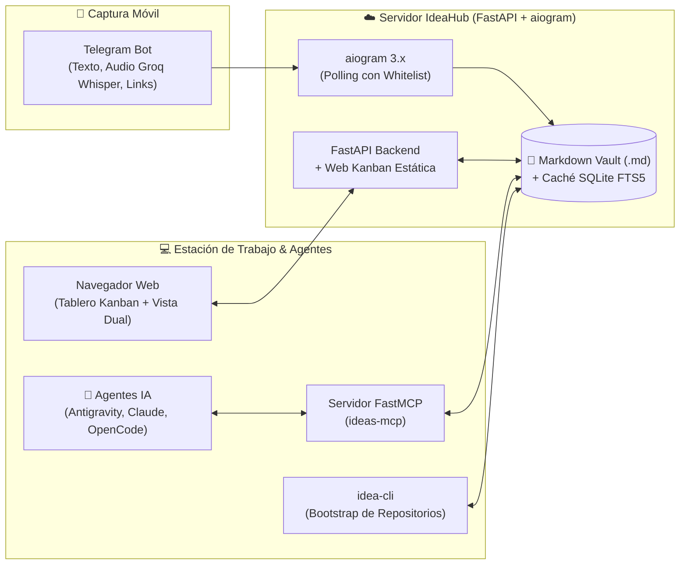

# IdeaHub 💡

> **Sistema híbrido de captura de ideas vía Telegram, gestión en Web Kanban y puente de contexto Model Context Protocol (MCP) para agentes de Inteligencia Artificial.**

IdeaHub es una plataforma personal diseñada bajo los principios de *Simplicity First* y *Zero-Overhead*, pensada para operar 24/7 en servidores de bajos recursos (como instancias Oracle Cloud ARM64 consumiendo menos de 50 MB de RAM en reposo). Permite registrar ideas de proyectos desde el móvil con Telegram (texto, notas de voz transcritas o enlaces), administrarlas visualmente mediante un tablero Kanban con editor dual, y conectarlas directamente a agentes de desarrollo autónomo (Antigravity, Claude Code, OpenCode, Cursor) mediante un servidor FastMCP y una herramienta de línea de comandos (`idea-cli`).

---

## 🏗️ Arquitectura del Sistema

IdeaHub centraliza el almacenamiento en un **Vault Markdown** versionable en Git, acelerado con un índice en memoria/disco **SQLite FTS5** para búsquedas full-text ultrarrápidas.



---

## 🚀 Características Principales

- **Captura sin fricción vía Telegram:**
  - Envío de notas de texto, enlaces (con auto-extracción de metadatos) o notas de voz.
  - Transcripción instantánea de audio en español utilizando **Groq Whisper Large v3 Turbo**.
  - Síntesis automática de especificaciones técnicas preliminares con modelos LLM.
  - Respuestas por *Reply* para anexar notas directamente a la bitácora de una idea existente.
  - Seguridad mediante lista blanca estricta por `TELEGRAM_ALLOWED_USER_ID`.
- **Tablero Web Kanban Mobile-First:**
  - Tablero responsivo accesible desde móvil y PC a través de la red privada **Tailscale**.
  - Flujo de estados: `inbox` 📥, `refining` 🔍, `agent_ready` 🤖, `in_progress` 🚧, `done` ✅ y `archived` 📦.
  - Vista dual: especificación técnica (`SPEC.md`) y bitácora cronológica de captura/progreso (`capture_log`).
  - Acceso directo a aplicaciones desplegadas (`app_url`) y menú de proyectos en vivo.
- **Puente para Agentes de IA (MCP):**
  - Servidor `FastMCP` (`ideas-mcp`) con herramientas nativas para consultar, modificar y transicionar ideas.
  - Permite a los agentes de codificación autónoma inspeccionar el contexto del proyecto sin copiar y pegar manualmente.
- **Herramienta CLI de Inicialización (`idea-cli`):**
  - `idea-cli init <ID>` crea un nuevo repositorio Git local, descarga el `SPEC.md`, genera el checklist en `TASKS.md` y marca la idea como `in_progress`.

---

## 📂 Estructura del Repositorio

```text
idea-hub/
├── app/
│   ├── api/                 # Endpoints REST de FastAPI y autenticación
│   │   ├── auth.py          # Manejo de sesiones por Cookie Bearer/Token
│   │   └── routes.py        # Rutas CRUD de ideas, logs y estados
│   ├── bot/                 # Lógica del Bot de Telegram (aiogram 3.x)
│   │   ├── keyboards.py     # Teclados inline para acciones rápidas
│   │   ├── middlewares.py   # Control de acceso por ID de usuario
│   │   └── router.py        # Handlers de texto, voz, audio y comandos
│   ├── services/            # Lógica de negocio y conectores de IA
│   │   ├── ai_service.py    # Integración con Groq (Whisper + Llama/Groq LLM)
│   │   └── idea_service.py  # Orquestador del Vault, búsqueda e inicialización
│   ├── storage/             # Capa de persistencia
│   │   ├── markdown_vault.py# Almacenamiento en ficheros Markdown (.md con Frontmatter)
│   │   └── sqlite_index.py  # Índice FTS5 en SQLite para consultas rápidas
│   ├── cli.py               # Herramienta Typer: idea-cli (list, show, init)
│   ├── config.py            # Configuración con Pydantic Settings
│   ├── main.py              # Punto de entrada unificado (FastAPI + Polling aiogram)
│   ├── mcp_server.py        # Servidor FastMCP para agentes de IA (ideas-mcp)
│   └── models.py            # Modelos Pydantic y enumeraciones de estado
├── data/
│   ├── vault/               # Directorio de ideas (001, 002, ...) con su SPEC.md
│   └── index.sqlite         # Base de datos SQLite (índice FTS5 y caché)
├── web/                     # Frontend estático servido directamente por FastAPI
│   ├── index.html           # Interfaz HTML5 responsiva
│   ├── style.css            # Estilos mobile-first Kanban y vista dual
│   └── app.js               # Lógica de renderizado y comunicación REST
├── tests/                   # Suite completa de pruebas automatizadas (pytest)
├── pyproject.toml           # Metadatos del paquete y dependencias de Python
└── .env.example             # Plantilla de variables de entorno
```

---

## ⚙️ Variables de Entorno

Copia el archivo `.env.example` como `.env.local` (o `.env`):

```bash
cp .env.example .env.local
```

| Variable | Descripción | Ejemplo / Valor por defecto |
| :--- | :--- | :--- |
| `TELEGRAM_BOT_TOKEN` | Token del bot provisto por BotFather en Telegram | `123456789:ABCdef...` |
| `TELEGRAM_ALLOWED_USER_ID` | Tu User ID numérico de Telegram (Whitelist) | `987654321` |
| `API_HOST` | Host para escuchar peticiones de la API y Web | `0.0.0.0` |
| `API_PORT` | Puerto de escucha de la aplicación Web / API | `8090` |
| `IDEAHUB_API_TOKEN` | Token secreto para llamadas autenticadas a la API y MCP | `tu-token-seguro` |
| `IDEAHUB_WEB_PASSWORD` | Contraseña para iniciar sesión en la interfaz Web | `tu-password-web` |
| `WEB_AUTH_SECRET` | Clave secreta para la firma de cookies de sesión | `tu-clave-aleatoria` |
| `AI_BASE_URL` | Endpoint OpenAI-compatible para transcripción y texto | `https://api.groq.com/openai/v1` |
| `AI_API_KEY` | Clave de API para Groq (o servicio compatible) | `gsk_...` |
| `DATA_DIR` | Ruta al directorio raíz de almacenamiento de datos | `./data` |
| `SQLITE_PATH` | Ruta al fichero de la base de datos de índice SQLite | `./data/index.sqlite` |
| `DISABLE_BOT_POLLING` | Desactiva el bot en background (útil para tests o workers web puros) | `false` |

---

## 🛠️ Instalación y Configuración

### 1. Requisitos Previos
- Python 3.11 o superior.
- Git.
- Clave de API de [Groq Cloud](https://console.groq.com/) (para transcripción Whisper y refinamiento).
- Token de Bot de Telegram y tu ID de usuario de Telegram.

### 2. Preparar el Entorno Virtual

```bash
# Clonar el repositorio
git clone <URL_REPOSITORIO> idea-hub
cd idea-hub

# Crear y activar el entorno virtual
python3 -m venv .venv
source .venv/bin/activate

# Instalar el paquete en modo editable junto con dependencias de desarrollo
pip install -e ".[dev]"
```

---

## 🖥️ Modos de Ejecución

### Modo Desarrollo / Local

Para iniciar el servidor localmente (incluye tanto la Web/API como el polling del bot):

```bash
source .venv/bin/activate
uvicorn app.main:app --host 0.0.0.0 --port 8090 --reload
```

Accede a la interfaz web en: `http://localhost:8090` (o `http://<IP_TAILSCALE>:8090`).

### Modo Producción con `systemd`

En el servidor (por ejemplo, en Oracle Cloud), se configura un servicio persistente administrado por `systemd`. Puedes tomar como base el archivo `idea-hub.service.example`:

```bash
# Copiar el servicio a systemd
sudo cp idea-hub.service.example /etc/systemd/system/idea-hub.service

# Recargar los daemons y habilitar el inicio automático
sudo systemctl daemon-reload
sudo systemctl enable idea-hub.service
sudo systemctl start idea-hub.service

# Comprobar el estado y uso de recursos
sudo systemctl status idea-hub.service

# Ver logs en vivo
sudo journalctl -u idea-hub.service -f
```

---

## 📖 Guías de Uso

### 1. Bot de Telegram
- `/start`: Muestra el mensaje de bienvenida y estado del bot.
- `/help`: Muestra la guía de comandos.
- **Captura rápida:** Simplemente escribe cualquier texto o envía un enlace al chat del bot. Se creará una tarjeta en estado `inbox`.
- **Notas de voz:** Graba un audio en Telegram. El bot transcribirá el mensaje con Groq Whisper, extraerá la idea principal y la guardará automáticamente.
- **Anexar a idea existente (Reply):** Responde a cualquier mensaje anterior del bot para agregar una nota o actualización a la bitácora (`capture_log`) de esa idea.

### 2. Tablero Web Kanban
- Ingresa a `http://localhost:8090` (o vía tu IP en Tailscale).
- Inicia sesión con la contraseña definida en `IDEAHUB_WEB_PASSWORD`.
- Visualiza tus ideas organizadas en columnas.
- Usa los botones para mover ideas entre estados (`Inbox` ➡️ `Refining` ➡️ `Agent Ready` ➡️ `In Progress` ➡️ `Done`).
- Al seleccionar una idea, se despliega la **Vista Dual**: a la izquierda el `SPEC.md` editable y a la derecha la bitácora de captura cronológica.
- Si una idea tiene configurado `app_url` en su frontmatter, aparecerá un botón directo para abrir la aplicación web resultante.

### 3. Herramienta CLI (`idea-cli`)

El paquete expone el comando `idea-cli` para gestionar ideas desde la terminal:

```bash
# Listar todas las ideas en el vault
idea-cli list

# Ver el detalle técnico y bitácora de una idea
idea-cli show 005

# Inicializar un nuevo proyecto a partir de una idea:
# Crea la carpeta del proyecto, ejecuta git init -b main,
# escribe SPEC.md y TASKS.md, y actualiza el estado a in_progress.
idea-cli init 005 ~/Documentos/git/
```

### 4. Servidor FastMCP (`ideas-mcp`) para Agentes de IA

IdeaHub incluye un servidor MCP estándar compatible con **Antigravity**, **Claude Code**, **OpenCode** y **Cursor**.

#### Herramientas MCP disponibles:
1. `list_ideas(status, tag, query)`: Filtra y lista ideas del vault usando búsqueda full-text FTS5.
2. `get_idea_spec(idea_id)`: Recupera la especificación técnica completa (`SPEC.md`) y la bitácora.
3. `update_idea_spec(idea_id, new_spec_markdown)`: Modifica la especificación preservando el historial.
4. `set_idea_status(idea_id, status, repo_path)`: Cambia el estado de la idea (`inbox`, `refining`, `agent_ready`, `in_progress`, `done`, `archived`).
5. `append_idea_note(idea_id, note)`: Añade notas de progreso a la bitácora cronológica.

#### Configuración en Agentes (ej. Claude Desktop / Antigravity):

Agrega el siguiente bloque a tu archivo de configuración de servidores MCP:

```json
{
  "mcpServers": {
    "ideahub": {
      "command": "/home/ubuntu/Documentos/git/idea-hub/.venv/bin/ideas-mcp",
      "env": {
        "DATA_DIR": "/home/ubuntu/Documentos/git/idea-hub/data",
        "SQLITE_PATH": "/home/ubuntu/Documentos/git/idea-hub/data/index.sqlite"
      }
    }
  }
}
```

---

## 🧪 Pruebas Automatizadas

La suite de pruebas cubre validaciones unitarias e integrales para el Core, el Bot de Telegram, la API REST, el Servidor MCP, el CLI y el Frontend Web:

```bash
source .venv/bin/activate
pytest
```

---

## 📚 Documentación Técnica Adicional

Para más detalles sobre las decisiones de diseño arquitectónico y operativos, consulta los informes en el repositorio `personal-docs`:
- `/home/ubuntu/Documentos/git/personal-docs/25-arquitectura-sistema-gestion-ideas-telegram-web-mcp.md` (Arquitectura general y protocolos).
- `/home/ubuntu/Documentos/git/personal-docs/27-operacion-despliegue-ideahub-oracle-cloud-tailscale-y-sincronizacion-dotfiles.md` (Guía de despliegue en Oracle Cloud ARM64 y Tailscale).
- `/home/ubuntu/Documentos/git/personal-docs/28-rediseno-responsivo-mobile-first-ideahub-kanban-y-vista-dual.md` (Diseño mobile-first y componentes UI).
